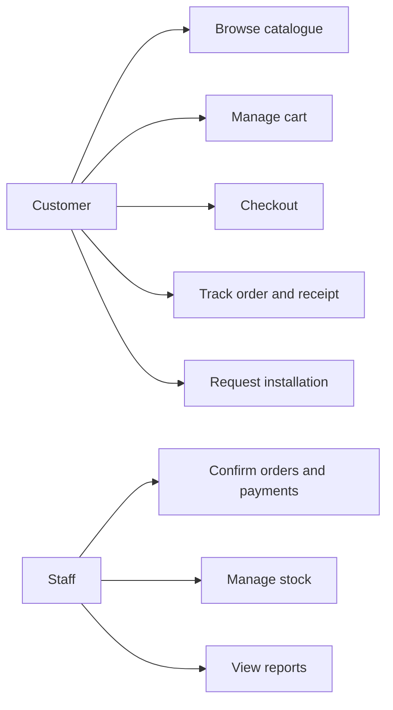
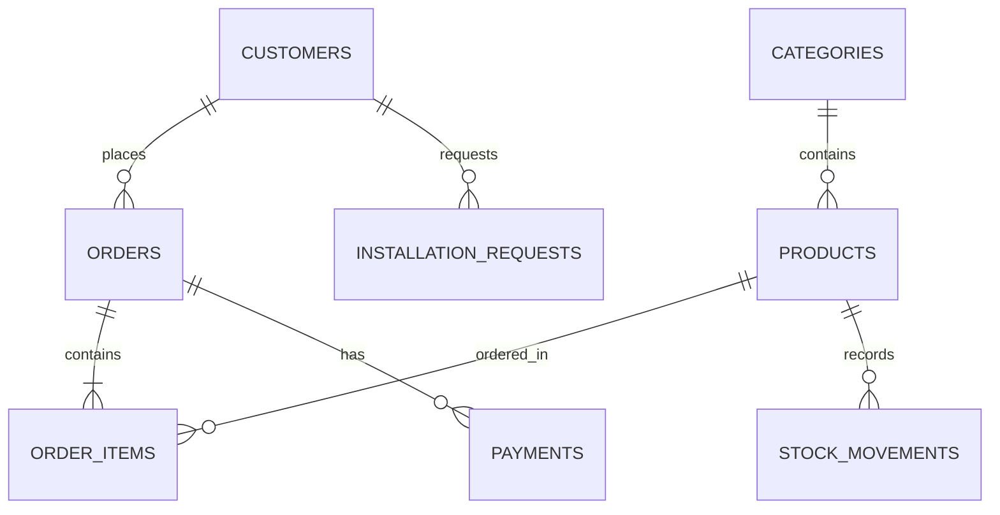

# Design and Implementation of an Online Internet and Starlink Accessories Store

## Case Study: Sammy Tech, Juba, South Sudan

## Problem Statement

Customers who need Starlink kits, Wi-Fi routers, accessories, and installation services in Juba often rely on physical visits and phone calls. This makes stock checking, payment verification, order follow-up, and sales reporting difficult. Sammy Tech needs a web-based system that organizes product sales, customer orders, payments, stock, and installation work.

## Aim and Objectives

The aim is to implement an online store for Sammy Tech using PHP, MySQL, HTML, CSS, and JavaScript.

1. Display Internet and Starlink accessories online.
2. Allow customers to order multiple products through a cart.
3. Capture payment, delivery, and customer details.
4. Provide tracking, receipts, and installation requests.
5. Provide staff tools for products, orders, payments, inventory, installations, and reports.

## How the System Works

```text
Customer browses products
        |
        v
Adds products to the session cart
        |
        v
Completes checkout with delivery and payment details
        |
        v
PHP saves customer, order, order items, and payment records in MySQL
        |
        v
Staff confirm stock and the order in the dashboard
        |
        v
System deducts stock in a locked database transaction
        |
        v
Customer tracks the order and prints a receipt
```

At checkout, stock is not deducted. Staff confirmation checks available stock and deducts it safely. If a confirmed order is cancelled, stock is restored and a stock movement is recorded.

## Functional Requirements

- Product catalogue and category filtering.
- Multiple-item cart, quantity updates, removals, and totals.
- Pickup or delivery checkout with address, landmark, and alternative phone.
- Cash, mobile money, or bank-transfer payment capture.
- Payment reference and optional proof upload.
- Order tracking using order number and phone number.
- Printable receipts.
- Staff order and payment confirmation.
- Installation requests and reporting.

## Non-Functional Requirements

- Responsive user interface.
- Secure sessions, password hashing, CSRF protection, prepared SQL statements, and input validation.
- Private payment-proof storage.
- MySQL data persistence and stock audit history.

## Diagrams

### Use Case Diagram



### ER Diagram



## Database Dictionary

| Table | Purpose |
| --- | --- |
| administrators | Staff usernames and password hashes. |
| categories | Product categories. |
| products | Product, price, stock, and status details. |
| customers | Customer contacts. |
| orders | Main order, delivery, payment, and fulfilment data. |
| order_items | Products and quantities for each order. |
| payments | Payment method, amount, proof, and confirmation status. |
| addresses | Structured delivery address information. |
| installation_requests | Installation service, location, date, and status. |
| stock_movements | Inventory deductions and restoration history. |

## Installation Instructions

1. Start Apache and MySQL in XAMPP or WAMP.
2. Open `http://localhost/sammy_tech_store/`.
3. Update `config/database.php` if local MySQL credentials differ.
4. The local database and sample products initialize automatically.
5. Create staff access with:

```powershell
php scripts/create_admin.php adminname a-secure-password-of-12-or-more-characters
```

6. Sign in at `/admin/login.php`.

## Conclusion

Sammy Tech converts manual connectivity-product sales into an organized online workflow with multi-item orders, payment records, stock safety, installation support, customer tracking, and operational reports.
